# Cubrí Seguros · Flujo de contratación digital

TP5 de Diseño UX/UI (Licenciatura en Sistemas de Información, FCyT). Front-end de un checkout de **Seguro de Celular** en 4 pasos (cotizar, elegir plan, datos personales y pago), con pantallas de éxito y de error de pago. Sin backend ni pagos reales.

- **Sitio publicado:** _(pegar acá la URL)_
- **Diseño en Figma:** https://www.figma.com/design/vJrfOUfiOI7OSeTtRfCloh

## Stack

HTML5 · Tailwind CSS v4 · Basecoat UI · JavaScript vanilla (módulos ES) · Vite.

No se usan frameworks ni librerías de validación.

## Cómo correrlo

Requiere [Node.js](https://nodejs.org) (versión LTS).

```bash
npm install
npm run dev      # servidor local en http://localhost:5173
npm run build    # genera la carpeta dist/ para publicar
```

> No se puede abrir `index.html` con doble click ni con Live Server: Vite tiene que compilar Tailwind y los módulos.

Tarjetas de prueba (el pago es simulado):

| Número | Resultado |
|---|---|
| `4111 1111 1111 1111` | Aprobado |
| `4000 0000 0000 0002` | Rechazado |
| Cualquier otro de 16 dígitos | Aprobado |

## Estructura

```
src/
├── main.js            arranque y navegación
├── estado.js          objeto único `solicitud` + irAPaso()
├── render.js          pinta cada paso a partir del estado
├── formularios.js     inputs <-> estado, errores en línea, botones
├── validaciones.js    funciones puras: devuelven un mensaje o null
├── cotizador.js       calcularCuota() (única fuente de precios)
├── pago.js            simularPago() y generarPoliza()
├── formato.js         formato de moneda (Intl.NumberFormat es-AR)
├── componentes/       header y stepper
└── pasos/             un módulo por pantalla
public/data/planes.json  planes y tasas, cargados con fetch
```

## Decisiones tomadas

- **Un único estado.** Toda la información del flujo vive en `solicitud`. Cada evento modifica el estado y después se llama a `render()`; el DOM nunca se lee para calcular nada.
- **Componentización.** La consigna sugería una sola página, pero volcar las 7 pantallas en un `index.html` lo vuelve inmantenible. Cada pantalla es un módulo en `src/pasos/` que genera su `<section data-paso="n">`, y `render()` las muestra u oculta con el atributo `hidden`.
- **Un solo resumen.** `renderResumen()` genera el resumen una sola vez para mobile y desktop (card lateral en desktop).
- **Un solo cálculo.** Planes y resumen usan `calcularCuota()`, así el precio nunca difiere entre pantallas.
- **Mobile first.** Se maqueta para 390 px y se agregan los cambios para 1440 px con el prefijo `lg:` de Tailwind.
- **Validación en el momento justo.** El error aparece al salir del campo (`blur`) y se corrige en vivo mientras se escribe. El botón deshabilitado indica qué falta completar.
- **Accesibilidad mínima.** Cada input tiene su `<label for>`, los errores usan `aria-invalid` y `role="alert"`, y al intentar avanzar con errores el foco va al primer campo inválido.
- **Pago sin doble click.** El botón se deshabilita apenas se hace click y solo se vuelve a habilitar si el pago falla.
- **Vencimiento.** Una tarjeta es válida hasta el último día del mes indicado.

## Casos de prueba de la cuota

| Valor | Antigüedad | Básico | Plus | Premium |
|---|---|---|---|---|
| $600.000 | menos de 1 año | $2.000 | $3.000 | $4.500 |
| $600.000 | 1 a 2 años | $2.200 | $3.300 | $4.950 |
| $1.200.000 | más de 2 años | $5.000 | $7.500 | $11.250 |

## Capturas

| Pantalla | Mobile (390) | Desktop (1440) |
|---|---|---|
| 01 · Inicio | 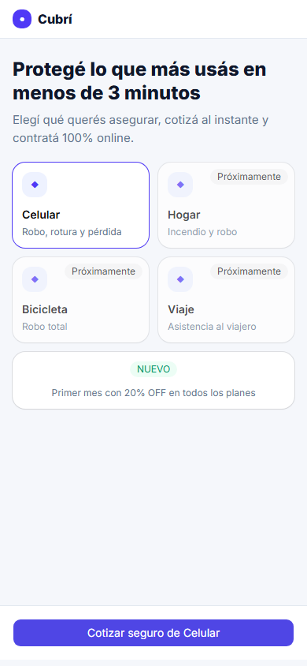 | 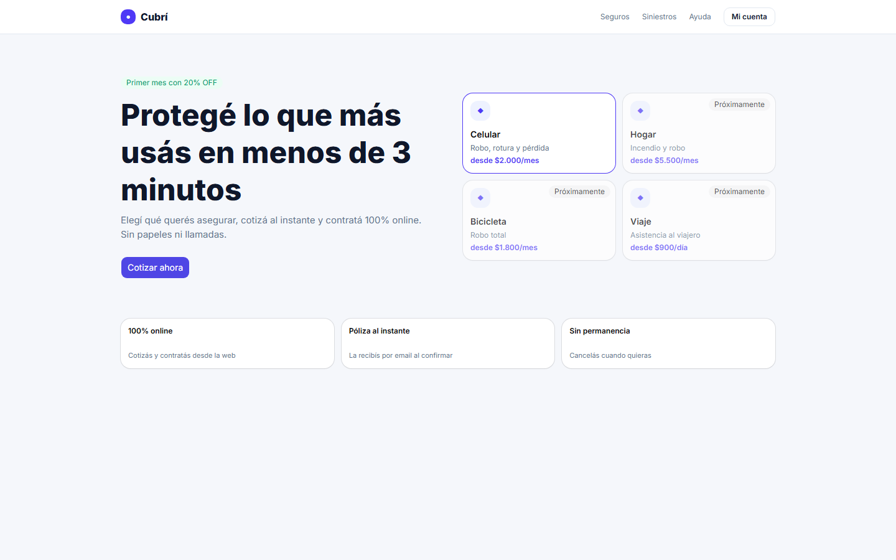 |
| 02 · Cotizar | 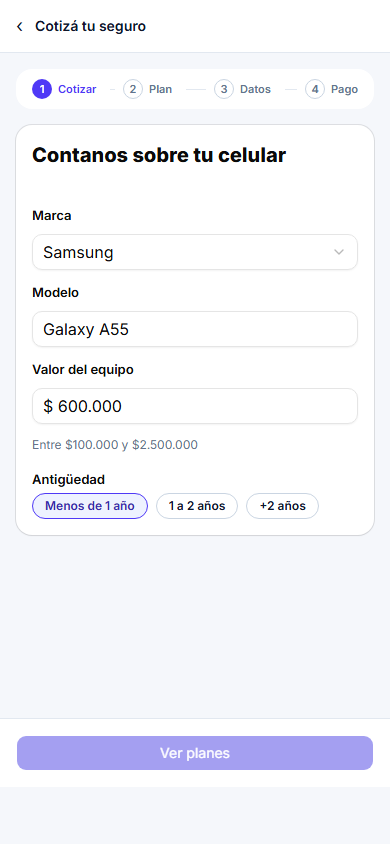 | 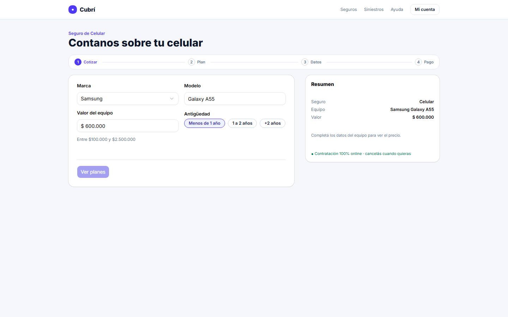 |
| 03 · Elegir plan | 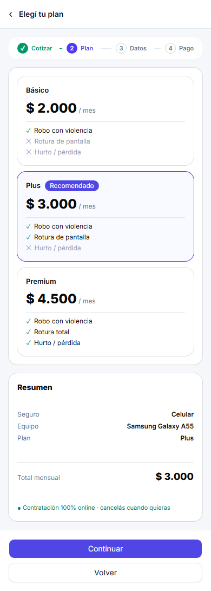 | 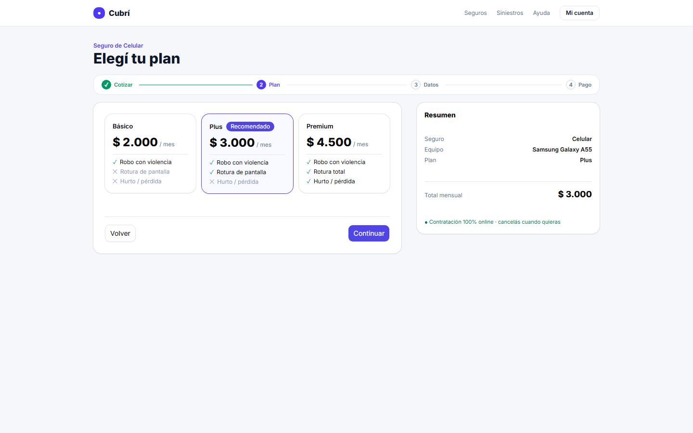 |
| 04 · Datos personales | 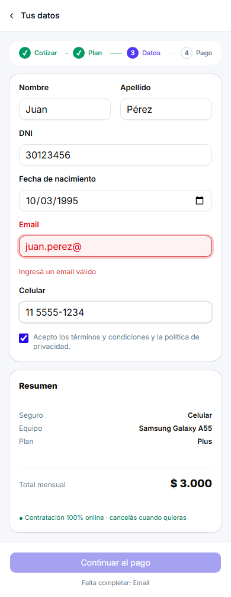 | 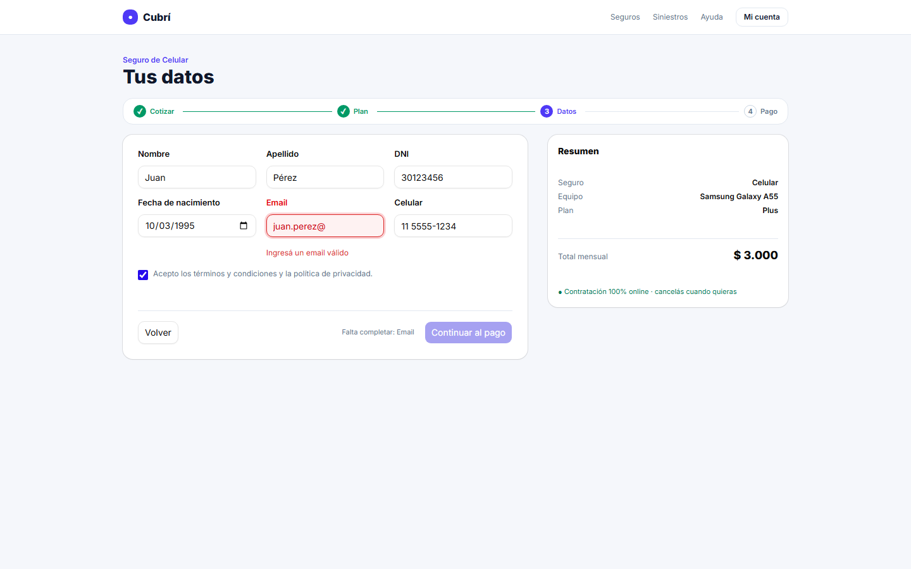 |
| 05 · Pago | 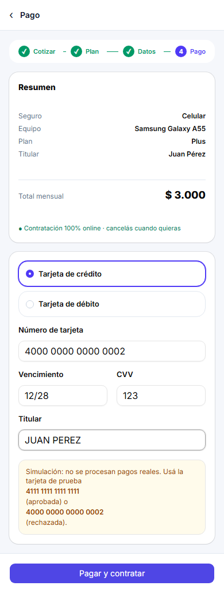 | 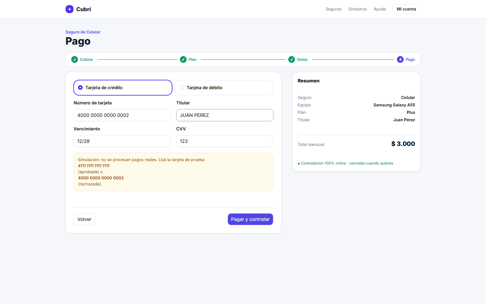 |
| 06 · Éxito | 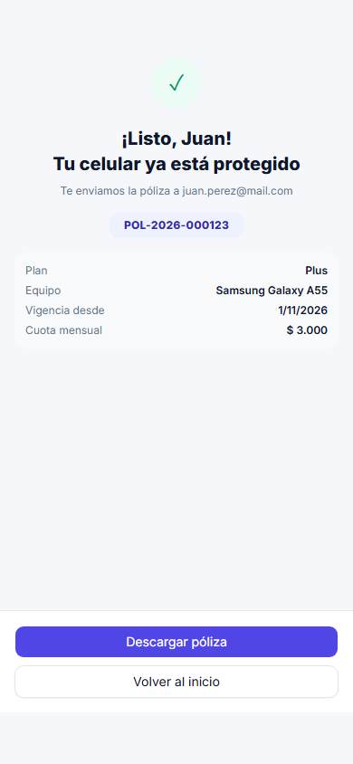 | 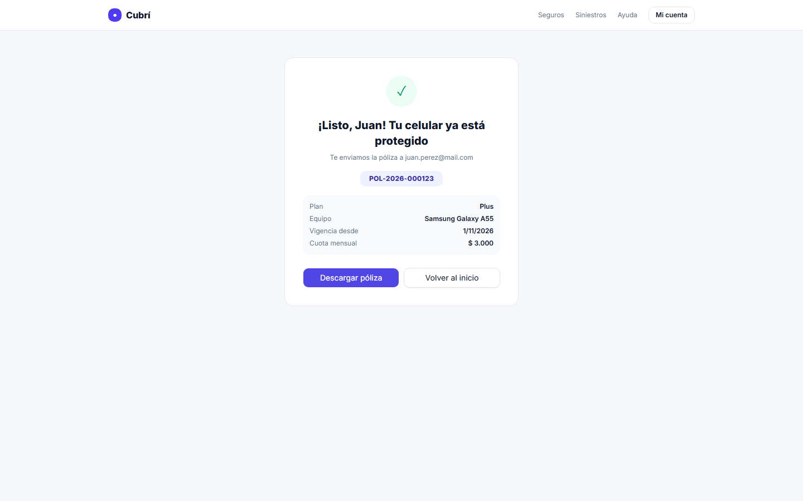 |
| 07 · Error de pago | 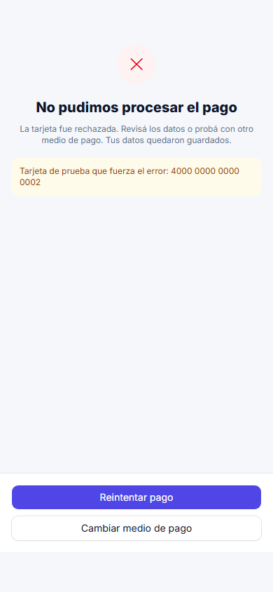 | 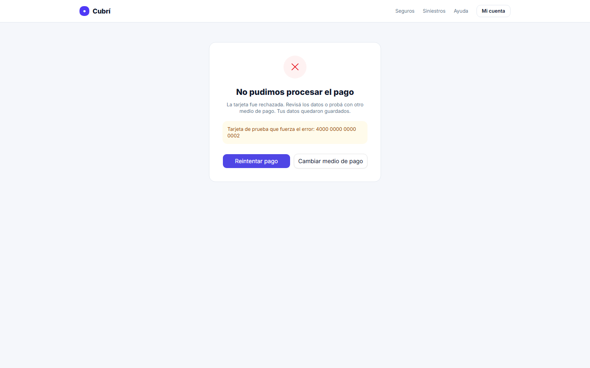 |

## Bonus realizados

- Setup con Vite + npm (opción 3.3 del enunciado).

## Uso de IA

Parte del código se generó con un asistente de IA a partir del enunciado y de capturas del Figma. Se revisó cada módulo y se probó el flujo completo (casos de prueba de cuotas, validaciones, pago aprobado y rechazado, y que "Volver" conserve los datos).
